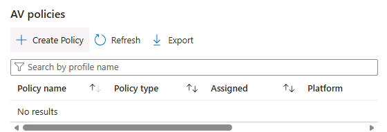
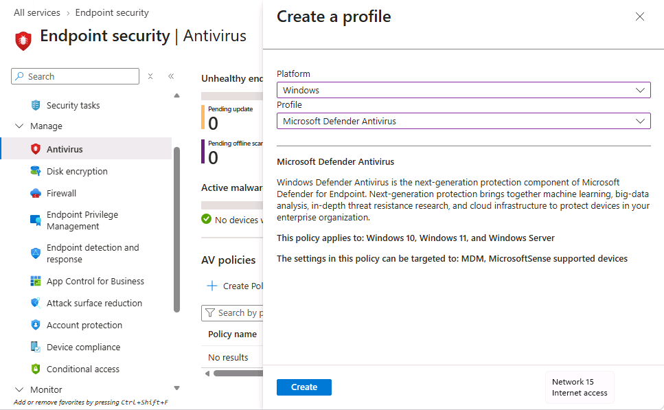
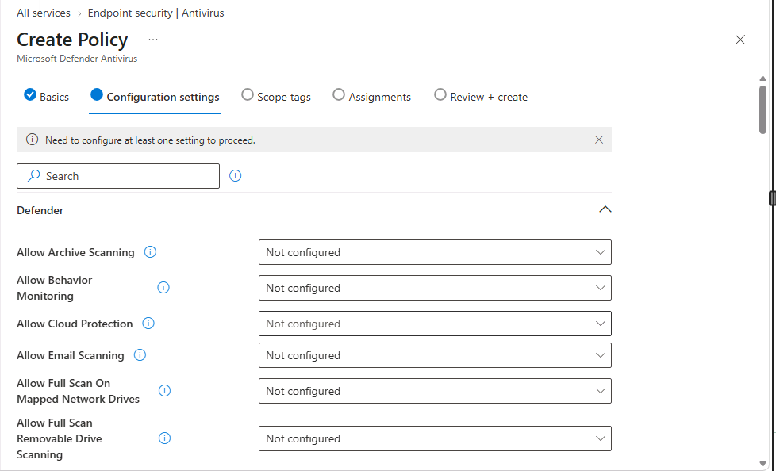
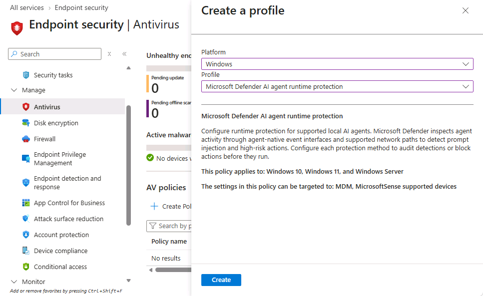
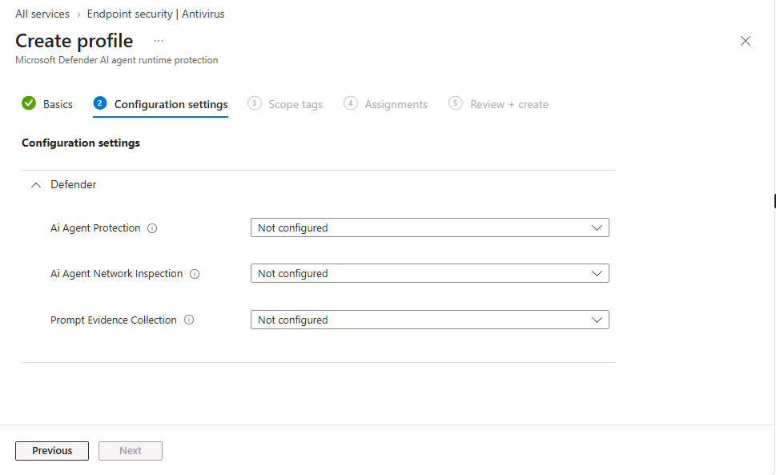

# Manage endpoint security in Microsoft Intune

**Estimated time:** 15 minutes.

Create a Windows policy with the Microsoft Defender Antivirus profile and, if available, a second policy with the Microsoft Defender AI agent runtime protection profile. You can check device deployment after configuring security settings management and onboarding.

Endpoint security policies group settings for specific security capabilities. In this activity, both example profiles are in **Endpoint security** > **Antivirus**.

Scope tags determine which objects admins can see. For this lab, don't add additional scope tags to either policy. For more information, see [Use role-based access control (RBAC) and scope tags for distributed IT](https://learn.microsoft.com/en-us/intune/fundamentals/role-based-access-control/scope-tags).

## Prerequisites

- Sign in to the [Microsoft Intune admin center](https://intune.microsoft.com/) with an authorized account in your test tenant. You need permission to create, read, and assign endpoint security policies and view their deployment reports.

## Create a Microsoft Defender Antivirus policy

Use the antivirus profile to configure behavior monitoring without changing unrelated settings.

1. In the Intune admin center, go to **Endpoint security** > **Antivirus** > **Create Policy**.

    

1. For **Platform**, select **Windows**. For **Profile**, select **Microsoft Defender Antivirus**, and then select **Create**.

    

1. On **Basics**, enter a unique name, such as `Test-Defender-AV`. Add a description, and select **Next**.
1. On **Configuration settings**, expand **Defender**. Locate **Allow Behavior Monitoring**, open its help text, and select the value that enables behavior monitoring. Leave the other settings **Not configured**.

    

    At least one setting needs a configured value before you can continue. For the setting's behavior and values, see [AllowBehaviorMonitoring](https://learn.microsoft.com/en-us/windows/client-management/mdm/policy-csp-defender#allowbehaviormonitoring). If the device already enforces this value, the exercise might not produce a visible change. Don't turn off tamper protection or behavior monitoring to force a change.
1. Select **Next**. On **Scope tags**, leave the existing tags unchanged without adding additional tags, and then select **Next**. If the **Scope tags** page isn't shown, continue to **Assignments**.
1. On **Assignments**, include only your dedicated Microsoft Entra test device group, and select **Next**.
1. On **Review + create**, confirm the profile, configured setting, scope tags, and assignment. Select **Create**.
1. Confirm that the policy appears in the antivirus policy list. Keep its name for the verification steps.

**Expected result:** A Microsoft Defender Antivirus policy exists with behavior monitoring enabled and only your test device group assigned. Creating the policy doesn't confirm that the device has applied it.

## Create an AI agent runtime protection policy (preview)

Use the AI profile as a second example of the policy-creation workflow. Configure audit-only modes confirmed by the setting help, and leave **Prompt Evidence Collection** unconfigured.

1. Go to **Endpoint security** > **Antivirus** > **Create Policy**.
1. Select **Windows** for **Platform** and **Microsoft Defender AI agent runtime protection** for **Profile**, and then select **Create**.

    

    If the profile isn't available, skip this exercise and its later verification. Don't substitute another profile; the Defender portal's preview switch doesn't control availability of this Intune profile.
1. On **Basics**, enter a unique name, such as `Test-Defender-AI-Audit`. Add a description that identifies it as an audit-only test policy, and select **Next**.
1. On **Configuration settings**, expand **Defender** and review these three settings:

    

    | Setting shown in the lab | Action |
    |---|---|
    | **Ai Agent Protection** | Open the setting help and dropdown, then select **Audit** (the option that enables protection in audit mode). |
    | **Ai Agent Network Inspection** | Open the setting help and dropdown, then select **Audit** (the option that enables protection in audit mode). |
    | **Prompt Evidence Collection** | Leave **Not configured**. This exercise doesn't configure collection of prompt evidence. |

    **Block** is available but isn't used in this lab. If either setting doesn't offer a mode that the help confirms is audit-only, exit the wizard without creating the policy. **Not configured** doesn't prevent another policy from configuring prompt evidence collection.
1. Select **Next**. On **Scope tags**, leave the existing tags unchanged without adding additional tags, and then select **Next**. If the **Scope tags** page isn't shown, continue to **Assignments**.
1. On **Assignments**, include only the same dedicated test device group, and select **Next**.
1. On **Review + create**, confirm the audit-only selections and assignment, and confirm that **Prompt Evidence Collection** is **Not configured**. Select **Create**.
1. Confirm that the policy appears in the antivirus policy list.

**Expected result:** If the preview was available, a separate AI agent runtime protection policy exists with both protections in audit mode and only your test device group assigned. This exercise demonstrates policy setup, not whether a supported agent has generated a detection.

## Verify policy creation

Check the saved configuration now. You can check device application after onboarding, not during this first activity.

1. In **Endpoint security** > **Antivirus**, open each policy you created. Review its properties and confirm its configured settings and assignment.
1. Record the policy names for the deployment checks after onboarding.

**Expected result:** You can identify the policies you created, explain their configured settings and target group, and distinguish policy creation from device application.

## Explore other endpoint security policies (optional)

These walkthroughs are read-only. Inspect the profiles without creating, saving, or assigning policies.

- **Firewall:** Go to **Endpoint security** > **Firewall** > **Create Policy**. Select **Windows** and inspect the **Windows Firewall** profile's configuration settings for Domain, Private, and Public networks. Exit without saving. Repeat with **Windows Firewall Rules** to inspect how individual rules specify direction, ports, protocols, and applications. See [Manage firewall settings with Intune](https://learn.microsoft.com/en-us/intune/device-configuration/endpoint-security/firewall).
- **Attack surface reduction:** Go to **Endpoint security** > **Attack surface reduction** and inspect the **Attack surface reduction rules** profile. Review rule actions such as **Block** and **Audit**, and compare rules for Office application behavior, executable content, and credential protection. See [Manage attack surface reduction settings with Intune](https://learn.microsoft.com/en-us/intune/device-configuration/endpoint-security/attack-surface-reduction).
- **Endpoint detection and response:** Go to **Endpoint security** > **Endpoint detection and response** and review the available profiles and Defender for Endpoint onboarding settings. Intune configures supported onboarding and EDR settings; Defender provides detection, investigation, and response. See the [EDR overview](https://learn.microsoft.com/en-us/defender-endpoint/overview-endpoint-detection-response).

When you're ready for [Activity 2: Configure security settings management](02-security-settings-management.md), return to the Defender portal and confirm **Endpoints** appears under **Settings**.

## Verify deployment after onboarding (optional)

Return to this section after completing security settings management and onboarding. Keep the policies assigned while the device receives its configuration.

Allow a few hours for the device to appear in the portal, check in, and show policy results in Intune. A manual sync requests a check-in; it doesn't make reporting immediate. If the device or results aren't visible yet, continue to [Activity 4](04-safe-deployment-channels.md) and return to this check before offboarding.

### Sync a device managed by Defender for Endpoint

For a device managed through Defender for Endpoint security settings management rather than Intune enrollment, use **Policy sync** in the Defender portal.

1. Sign in to the [Microsoft Defender portal](https://security.microsoft.com/).
1. Go to **Assets** > **Devices**, and select your lab test device.
1. On the device page, open the three-dot menu (**...**) next to **Set criticality** and select **Policy sync**. This action appears only for devices successfully managed by Defender for Endpoint. If it isn't available, check the device's management status, eligibility, and enforcement scope.
1. Allow time for policy processing, then review the deployment results below.

For more information, see [Device check-in frequency and on-demand policy sync](https://learn.microsoft.com/en-us/intune/device-security/microsoft-defender/security-settings-management#device-check-in-frequency).

### Check deployment results

1. In the Microsoft Intune admin center, go to **Groups** > **All groups**, select your dedicated test device group, and open **Members**. Confirm the onboarded device is in the group assigned to the policies you created.
1. In **Endpoint security** > **Antivirus**, open each policy you created.
1. Review the policy's device deployment report for the test device. Check for pending, error, or conflict results rather than assuming that a saved assignment means success.
1. If a policy hasn't applied, check device eligibility, group membership, synchronization, and conflicting policies. Don't change an existing baseline or weaken protection to resolve a lab result.
1. Use [View effective settings](05-effective-settings.md) to review the antivirus setting on the device. Don't assume that the AI profile appears in that same view.

**Expected result:** You can identify the test device's deployment result for each policy you created. A pending, error, or conflict result isn't confirmation that the device applied the policy.

## Clean up resources (optional)

Keep the policies assigned until you've finished your deployment and effective-settings checks. If you no longer need the policies you created for this exercise, you can remove them from your test tenant after verification.

1. In **Endpoint security** > **Antivirus**, locate each policy by the unique name you recorded.
1. If you have deletion permission, delete only the antivirus and AI policies you created for this exercise. Confirm their removal from the policy list. Don't delete shared policies, the security settings management configuration, or the safe deployment policy.

Deleting a policy doesn't confirm that every device setting has reverted.

## Related content

- [Endpoint security features in Microsoft Intune](https://learn.microsoft.com/en-us/intune/device-security/endpoint-security-policies#endpoint-security-features)
- [Create endpoint security policies](https://learn.microsoft.com/en-us/intune/device-configuration/endpoint-security/manage-policies#create-endpoint-security-policies)
- [Microsoft Defender AI agent runtime protection](https://learn.microsoft.com/en-us/defender-endpoint/ai-agent-runtime-protection-overview)

[Lab agenda](README.md) | [Next: Configure security settings management](02-security-settings-management.md)
