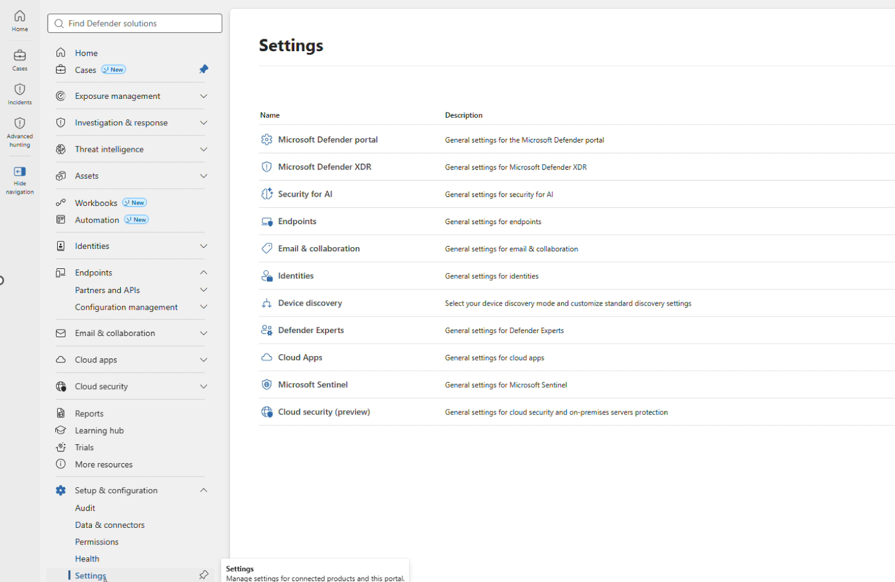
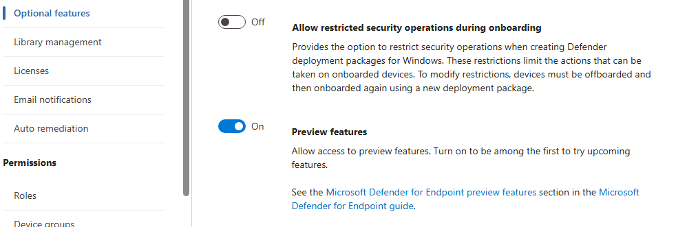
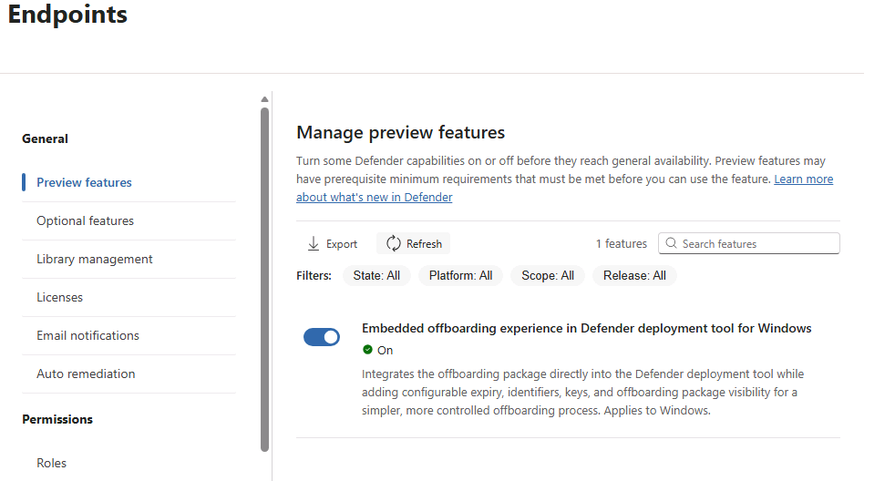
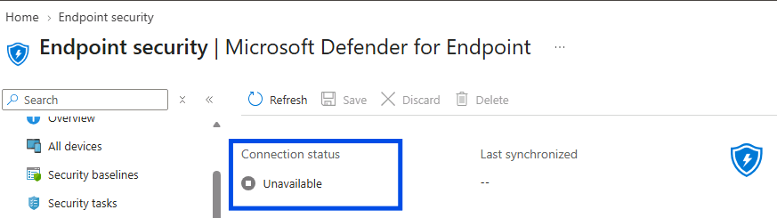
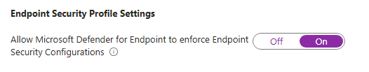

# Manage devices with Defender for Endpoint that aren't enrolled in Intune

**Estimated time:** 10 minutes.

Enable Microsoft Defender for Endpoint security settings management. This capability lets you use Intune endpoint security policies to manage Defender settings on devices that aren't enrolled in Intune.

For more information, see [Use Intune to manage Microsoft Defender settings on devices that aren't enrolled with Intune](https://learn.microsoft.com/intune/device-security/microsoft-defender/security-settings-management).

## Verify public preview features

1. Return to the Microsoft Defender portal and refresh. Continue once **Endpoints** appears under **Setup & configuration** > **Settings**.

    

1. To try embedded offboarding in Activity 6, open **Endpoints** > **Optional features**. If **Preview features** is available and off, turn it **On**, select **Save preferences**, and refresh. Leave unrelated options unchanged.

    

1. Open **Preview features**. If available, enable **Embedded offboarding experience in Defender deployment tool for Windows**. If either preview control is unavailable, continue and use the [standard offboarding fallback in Activity 6](06-offboard-devices.md#enable-embedded-offboarding).

    

## Connect Intune and Defender for Endpoint

1. Sign in to the [Microsoft Intune admin center](https://intune.microsoft.com/) with an account authorized to configure the connector in your test tenant.
1. Go to **Endpoint security** > **Microsoft Defender for Endpoint**.
1. If the Defender connection isn't configured, select **Connect Microsoft Defender for Endpoint to Microsoft Intune in the Microsoft Defender Security Center**. Follow any prompts in the Defender tab, return to Intune, and select **Refresh**.

    

1. Under **Endpoint Security Profile Settings**, set **Allow Microsoft Defender for Endpoint to enforce Endpoint Security Configurations** to **On**.

    

1. Select **Save** and confirm the **Connector settings saved** notification.

    

    

This setting allows eligible devices that are onboarded to Defender for Endpoint, but not enrolled in Intune, to receive endpoint security policies through the Defender for Endpoint management channel.

## Configure the enforcement scope

1. Sign in to the [Microsoft Defender portal](https://security.microsoft.com/).
1. Go to **Setup & configuration** > **Settings** > **Endpoints**.
1. Under **Configuration management**, select **Enforcement scope**.
1. Enable **Use MDE to enforce security configuration settings from Intune**.
1. Enable **Windows client devices** for this exercise. Use the limited, tagged-device scope where available. In Activity 3, apply the `MDE-Management` tag to your test device after it appears in Defender. Use the all-devices enforcement scope only in a dedicated test tenant where every eligible Windows client is intended to be in scope. Don't enable additional platforms for the exercise.
1. Review options for devices managed by Configuration Manager or onboarded through Defender for Cloud.
1. Select **Save**.

Devices must be included in this enforcement scope before they can complete enrollment into Defender for Endpoint security settings management. If **Manage security settings using Configuration Manager** is enabled, devices with a Configuration Manager client are excluded from Defender for Endpoint security settings management. If it's disabled, eligible devices with the Configuration Manager client can receive policy through the Defender for Endpoint management channel.

[Previous: Manage endpoint security in Microsoft Intune](03-manage-endpoint-security.md) | [Lab agenda](README.md) | [Next: Onboard devices](02-onboard-devices.md)
