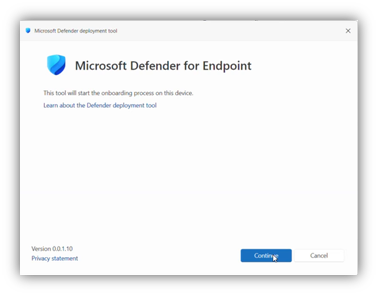
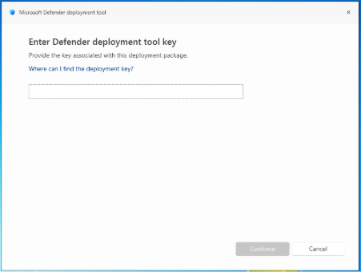

# Onboard devices

**Estimated time:** 15 minutes.

Onboard devices to Defender for Endpoint by using Intune or the Microsoft Defender portal.

For more information, see:

- [Use the Microsoft Defender deployment tool for Windows](https://learn.microsoft.com/defender-endpoint/defender-deployment-tool-windows)
- [Onboard Windows devices to Microsoft Defender for Endpoint by using Microsoft Intune](https://learn.microsoft.com/defender-endpoint/configure-endpoints-mdm)

## Create the onboarding package

1. In the Microsoft Defender portal, go to **Assets** > **Devices** > **Onboard**.
1. Under **Defender deployment tool**, select **Onboard**.
1. On the **Generate Defender deployment tool with an access key** page, enter a unique, descriptive package name, and then select **Generate**.
1. Copy and securely save the key. You can't access the key again after you leave the page.
1. Select **Download deployment tool**.
1. Copy the deployment tool executable to the device that you want to onboard.

## Run the onboarding package

Use either of the following methods:

- To use the executable, double-click it, select **Continue**, and paste the key when prompted.

	

	

- To use the command line, open Command Prompt as an administrator and run:

	```console
	<package-name>.exe -key:"<onboarding-key>"
	```

	For a silent installation, append the `-quiet` parameter.

## Verify onboarding

Verify that the device appears in the Microsoft Defender portal, or review the deployment tool log:

```text
C:\ProgramData\Microsoft\DefenderDeploymentTool\DefenderDeploymentTool-<COMPUTERNAME>.log
```

The tool also records events in **Windows Logs** > **Application** with source **WDATPOnboarding**.

To view deployment packages, go to **Settings** > **Endpoints** > **Deployment packages** in the Microsoft Defender portal.

[Previous: Configure security settings management](01-security-settings-management.md) | [Lab agenda](README.md) | [Next: Enable configuration protection](03-configuration-protection.md)
