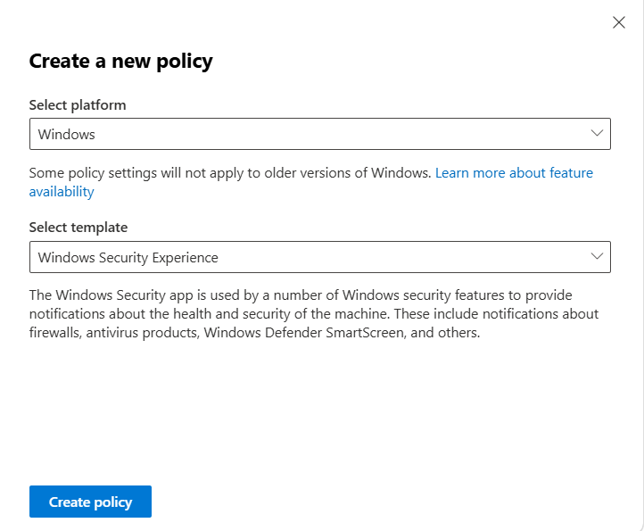
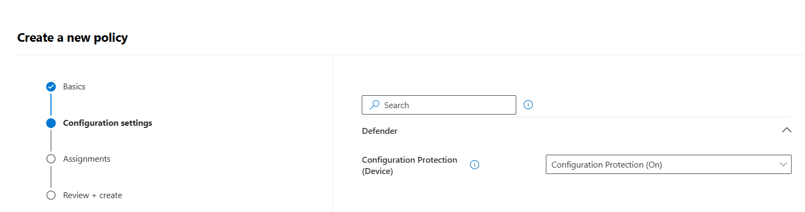

# Enable configuration protection and sync policy

**Estimated time:** 15 minutes for the core activity. Attempt the optional exclusion exercises only if there is enough time within the session for the checks and cleanup.

Configuration protection makes cloud-managed policy from Intune and Defender for Endpoint the authoritative source for Microsoft Defender Antivirus. Intune and Defender for Endpoint policies are enforced while conflicting settings from Group Policy, Configuration Manager, scripts, and local administrators are ignored.

Configuration protection differs from tamper protection. Tamper protection safeguards a limited set of critical settings by enforcing Microsoft-defined secure defaults. Configuration protection extends enforcement across a broader configuration surface, sets recommended security values, and enforces the settings defined by your organization.

For more information, see [Configuration protection in Microsoft Defender for Endpoint](https://learn.microsoft.com/defender-endpoint/secure-controlled-configuration).

Before you begin, confirm that the Windows device:

- Is onboarded to Defender for Endpoint.
- Is managed through Intune or Defender for Endpoint security settings management.

## Optional activity: Add a local antivirus exclusion before configuration protection

Use this activity to compare local administrator control before and after configuration protection is enabled, if time allows. If you skip it, continue to [Enable configuration protection](#enable-configuration-protection).

For this activity, use a Windows client lab device with the Windows Security app and the lab-provided local administrator account. Confirm that the device meets the [configuration protection prerequisites](https://learn.microsoft.com/defender-endpoint/secure-controlled-configuration#prerequisites), that configuration protection isn't already enabled, and that an existing policy doesn't disable local administrator merge.

> [!CAUTION]
> Antivirus exclusions reduce protection. Use only the provided lab device and the empty test folder specified here. Don't exclude a drive, a user profile, or folders containing applications or data. Don't turn off tamper protection or real-time protection to make this activity work.

1. Sign in to the Windows lab device with the lab-provided local administrator account.
1. In File Explorer, confirm that `C:\LAB712-AVExclusionTest` doesn't already exist, then create it as an empty folder. If it already exists, ask a proctor for help instead of reusing it.
1. Open **Windows PowerShell** as an administrator. Locate the latest installed Defender command-line tool and check the test folder:

    ```powershell
    $platform = Get-ChildItem -LiteralPath "$env:ProgramData\Microsoft\Windows Defender\Platform" -Directory -ErrorAction Stop |
        Sort-Object Name -Descending |
        Select-Object -First 1
    $mpCmdRun = Join-Path -Path $platform.FullName -ChildPath 'MpCmdRun.exe'
    & $mpCmdRun -CheckExclusion -Path 'C:\LAB712-AVExclusionTest'
    ```

    Confirm that the output says **is not excluded** and reports exit code **1** before you add the exclusion. If the tool isn't available, the command fails, or the folder is already excluded, ask a proctor to check the device. Don't treat a tool error as evidence that an exclusion is blocked.
1. Open **Windows Security** > **Virus & threat protection** > **Manage settings**. Under **Exclusions**, select **Add or remove exclusions**.
1. Select **Add an exclusion** > **Folder**, and select `C:\LAB712-AVExclusionTest`. Approve the administrator prompt if one appears.
1. In the same elevated PowerShell window, run the check again:

    ```powershell
    & $mpCmdRun -CheckExclusion -Path 'C:\LAB712-AVExclusionTest'
    ```

    **Expected result:** The output says **is excluded** and reports exit code **0**. You have demonstrated that the local administrator can add an effective antivirus exclusion before configuration protection is enabled.
1. In **Add or remove exclusions**, select only `C:\LAB712-AVExclusionTest` and select **Remove**. Run the check again and confirm **is not excluded**, with exit code **1**, so the next test starts without the exclusion.

Keep the empty folder and the PowerShell window open for the checks after policy application. If you can't add or remove the baseline exclusion, ask a proctor to check the existing policies; don't weaken device protection to force the expected result.

## Enable configuration protection

1. In the Microsoft Intune admin center, go to **Endpoint security** > **Antivirus** > **Create policy**.
1. Select **Windows** for the platform and **Windows Security Experience** for the profile.

	

1. Enter a descriptive name for the policy, and then select **Next**.
1. Under **Configuration settings**, locate **Controlled Configuration (Device)** and select **Controlled Configuration (On)**.

	

1. Under **Assignments**, select the device groups that should receive the policy.
1. Review the settings and select **Create**.

## Sync and verify configuration protection

Complete these steps whether or not you chose the optional exclusion activity.

1. In the Intune admin center, go to **All devices**, select the test device, and select **Sync** > **Yes**.
1. On the test device, use the existing elevated Windows PowerShell window if you completed the optional baseline. Otherwise, open Windows PowerShell as an administrator. Run:

    ```powershell
    Get-MpComputerStatus | Select-Object AMProductVersion, ControlledConfigurationState, IsTamperProtected
    ```

    Confirm that **ControlledConfigurationState** reports configuration protection as enabled. You can also check the device's effective settings in the Defender portal, as described in [View effective settings](05-effective-settings.md). Don't rely only on the policy being assigned, and don't continue until the device has applied it.

> [!IMPORTANT]
> Excluding a device or removing its policy assignment removes the value delivered by that policy.

## Optional activity: Verify that protection prevents a local exclusion

Complete this part only if you completed the baseline activity before enabling configuration protection. First complete [Sync and verify configuration protection](#sync-and-verify-configuration-protection).

1. While still signed in as the local administrator, return to **Windows Security** > **Virus & threat protection** > **Manage settings** > **Add or remove exclusions**. Try to add the same folder, `C:\LAB712-AVExclusionTest`.
1. In the same elevated PowerShell window, check the result:

    ```powershell
    & $mpCmdRun -CheckExclusion -Path 'C:\LAB712-AVExclusionTest'
    ```

    **Expected result:** The local administrator can't create an effective exclusion. The UI might prevent the change, or a locally recorded change might be ignored. The check reports **is not excluded**, with exit code **1**. A UI entry alone isn't proof that an exclusion is honored.

    If the folder is still excluded, ask a proctor to verify the applied configuration-protection state, whether a cloud policy explicitly enables local administrator merge, and whether a centrally managed exclusion covers the folder. Don't disable protection to troubleshoot the activity.

With configuration protection enabled, local antivirus exclusions aren't honored by default. An organization can explicitly allow them through a cloud-managed local administrator merge policy while keeping configuration protection enabled.

## Optional extension: Allow local antivirus exclusions through policy

Use this extension only with the instructor's approval and only for the test-device group. Allowing local exclusions is an exception to the protected default, not a recommendation for all devices.

The lab-provided policy-management account needs Intune **Security baselines** permissions to read, create, update, and assign antivirus policies, scoped to the lab test devices. See [Role-based access control for endpoint security](https://learn.microsoft.com/intune/device-configuration/endpoint-security/manage-policies#role-based-access-control-for-endpoint-security). If your account can't sync devices or remove the temporary policy, ask a proctor to perform those actions.

1. Using the lab-provided policy-management account, open the [Microsoft Intune admin center](https://intune.microsoft.com/). Go to **Endpoint security** > **Antivirus** > **Create policy**.
1. Select **Windows** for the platform and **Microsoft Defender Antivirus** for the profile. Name the policy `LAB712 - Allow local antivirus exclusions`.
1. Under **Configuration settings**, find **Disable Local Admin Merge** and select **Enable local admin merge**. If the portal shows Boolean values, set **Disable Local Admin Merge** to **False**.

    The setting name is inverted: **False** enables local administrator merge; **True** disables it. With configuration protection enabled, leaving the setting **Not configured** doesn't explicitly allow local antivirus exclusions.
1. Leave unrelated settings unconfigured. Assign the policy only to the dedicated lab test-device group, then review and create it. If another assigned policy explicitly disables local administrator merge, ask a proctor to resolve the conflicting lab assignments before proceeding.
1. Sync the test device and wait for policy application. Confirm the merge setting and that configuration protection remains enabled:

    ```powershell
    Get-MpPreference | Select-Object DisableLocalAdminMerge
    Get-MpComputerStatus | Select-Object ControlledConfigurationState
    ```

    **Expected result:** **DisableLocalAdminMerge** is **False**, and configuration protection is still enabled.
1. On the device, repeat the Windows Security steps to add `C:\LAB712-AVExclusionTest` as a folder exclusion. Run the check again:

    ```powershell
    & $mpCmdRun -CheckExclusion -Path 'C:\LAB712-AVExclusionTest'
    ```

    **Expected result:** The output says **is excluded**, with exit code **0**. The cloud policy now allows the local antivirus exclusion without turning off configuration protection.

This exception applies to local antivirus exclusions. Locally defined attack surface reduction exclusions aren't honored under configuration protection, even when local administrator merge is enabled. For more information, see [Configuration protection enforcement](https://learn.microsoft.com/defender-endpoint/secure-controlled-configuration#how-configuration-protection-enforcement-works) and [Disable Local Admin Merge policy values](https://learn.microsoft.com/defender-endpoint/use-intune-config-manager-microsoft-defender-antivirus#disable-local-admin-merge).

## Clean up the optional exclusion activity

1. If you completed the merge-policy extension, remove the test exclusion while local administrator merge is still allowed. In **Windows Security** > **Add or remove exclusions**, select only `C:\LAB712-AVExclusionTest` and select **Remove**. Alternatively, in elevated PowerShell, run:

    ```powershell
    Remove-MpPreference -ExclusionPath 'C:\LAB712-AVExclusionTest'
    ```

1. Run the exclusion check and confirm **is not excluded**, with exit code **1**. If you skipped the merge-policy extension, remove any test entry that the UI recorded and verify the same result. If removal is blocked or you can't confirm cleanup, ask a proctor to reset the disposable lab device before continuing; don't turn off protection.
1. If you created the temporary merge policy, change **Disable Local Admin Merge** to **Disable local admin merge** (**True** in a Boolean UI), sync the device, and verify **DisableLocalAdminMerge** is **True**. Confirm that configuration protection remains enabled and the test folder isn't excluded. Work with the instructor to remove the temporary policy and its assignment when the lab is reset; leave the original configuration-protection policy unchanged.
1. Delete only the empty `C:\LAB712-AVExclusionTest` folder you created. If it contains files, stop and ask a proctor for help instead of deleting its contents.

| Checkpoint | Expected effective result |
|---|---|
| Before configuration protection, after adding the test exclusion | The folder is excluded. |
| After configuration protection, without a cloud policy allowing local administrator merge | The local attempt doesn't create an effective exclusion. |
| After explicitly allowing local administrator merge through policy | The local antivirus exclusion is honored while configuration protection stays enabled. |
| After cleanup | The test folder isn't excluded, and configuration protection remains enabled. |

For details about the verification tool, see [Verify whether a file or folder is excluded by using MpCmdRun](https://learn.microsoft.com/defender-endpoint/microsoft-defender-antivirus-exclusions-configure#verify-whether-a-file-or-folder-is-excluded-by-using-mpcmdrun).

[Previous: Onboard devices](02-onboard-devices.md) | [Lab agenda](README.md) | [Next: Assign safe deployment channels](04-safe-deployment-channels.md)
