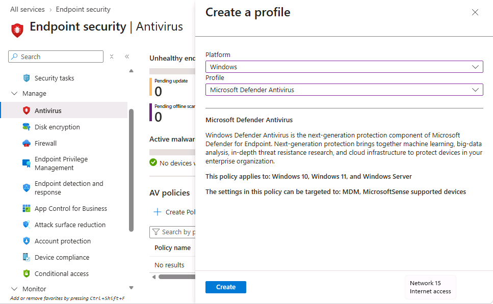
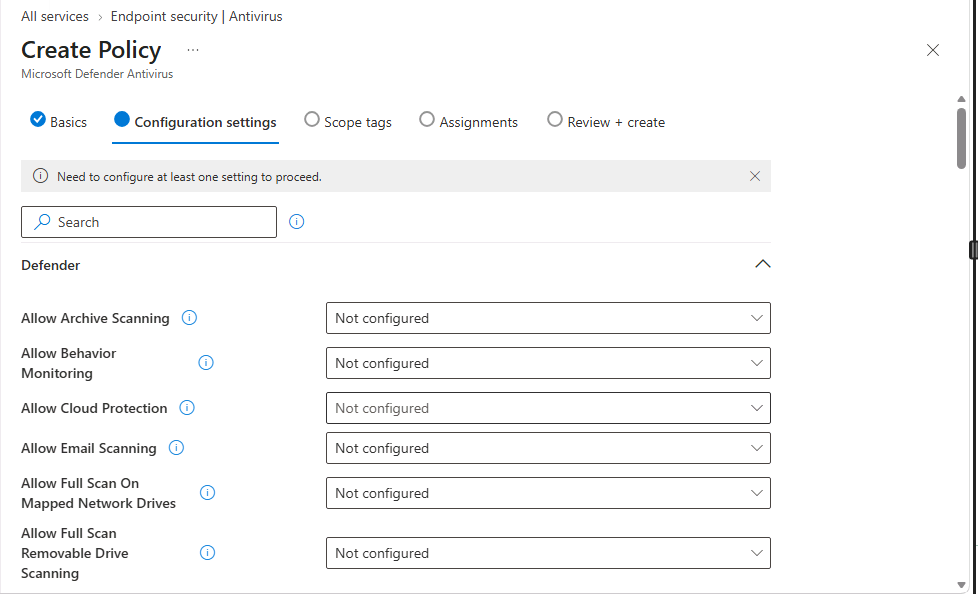
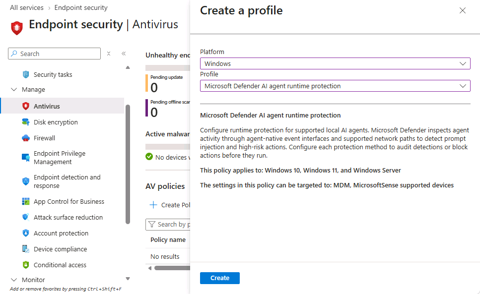
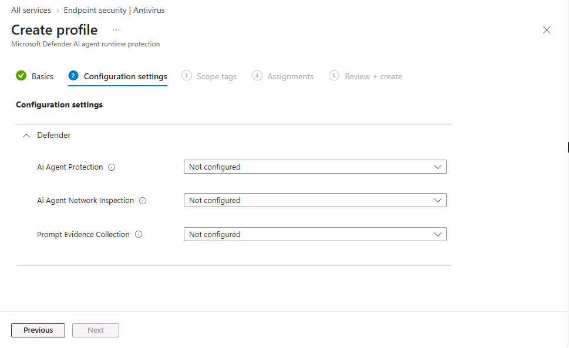

# Manage endpoint security in Microsoft Intune

**Estimated time:** 15 minutes.

Create two Windows endpoint security policies in Microsoft Intune: one with the Microsoft Defender Antivirus profile and one with the Microsoft Defender AI agent runtime protection profile. After the later security settings management and onboarding activities, return to check device deployment.

Endpoint security policies group settings for specific security capabilities. In this activity, both example profiles are in **Endpoint security** > **Antivirus**.

Scope tags determine which objects admins can see. For this lab, don't add additional scope tags to either policy. For more information, see [Use role-based access control (RBAC) and scope tags for distributed IT](https://learn.microsoft.com/en-us/intune/fundamentals/role-based-access-control/scope-tags).

## Prerequisites

- Sign in to the [Microsoft Intune admin center](https://intune.microsoft.com/) with the lab-provided policy-management account. The account needs permission to create, read, and assign endpoint security policies and view their deployment reports. Cleanup also requires permission to delete the exercise policies; ask a proctor to handle deletion if your account lacks that permission.

## Create a Microsoft Defender Antivirus policy

Use the antivirus profile to configure behavior monitoring without changing unrelated settings.

1. In the Intune admin center, go to **Endpoint security** > **Antivirus** > **Create Policy**.
1. For **Platform**, select **Windows**. For **Profile**, select **Microsoft Defender Antivirus**, and then select **Create**.

    

1. On **Basics**, enter a unique name, such as `LAB712-AV-<your-lab-identifier>`. Replace the placeholder with your lab identifier, not an email address or tenant identifier. Add a description, and select **Next**.
1. On **Configuration settings**, expand **Defender**. Locate **Allow Behavior Monitoring**, open its help text, and select the value that enables behavior monitoring. Leave the other settings **Not configured**.

    

    At least one setting needs a configured value before you can continue. For the setting's behavior and values, see [AllowBehaviorMonitoring](https://learn.microsoft.com/en-us/windows/client-management/mdm/policy-csp-defender#allowbehaviormonitoring). If the device already enforces this value, the exercise might not produce a visible change. Don't turn off tamper protection or behavior monitoring to force a change.
1. Select **Next**. On **Scope tags**, leave the existing tags unchanged without adding additional tags, and then select **Next**. If the **Scope tags** page isn't shown, continue to **Assignments**.
1. On **Assignments**, include only the lab test-device group. Verify the group name with the proctor, and select **Next**.
1. On **Review + create**, confirm the profile, configured setting, scope tags, and assignment. Select **Create**.
1. Confirm that the policy appears in the antivirus policy list. Keep its name for the verification steps.

**Expected result:** A Microsoft Defender Antivirus policy exists with behavior monitoring enabled in its configuration and only the lab test-device group assigned. Creating the policy doesn't confirm that the device has applied it.

## Create an AI agent runtime protection policy

Use the AI profile as a second example of the policy-creation workflow. Configure audit-only modes confirmed by the setting help, and leave **Prompt Evidence Collection** unconfigured.

1. Go to **Endpoint security** > **Antivirus** > **Create Policy**.
1. Select **Windows** for **Platform** and **Microsoft Defender AI agent runtime protection** for **Profile**, and then select **Create**.

    

    If the profile isn't available, ask a proctor for help. Don't substitute another profile; the Defender portal's preview switch doesn't establish availability of this Intune profile.
1. On **Basics**, enter a unique name, such as `LAB712-AI-Audit-<your-lab-identifier>`. Add a description that identifies it as a lab audit-only policy, and select **Next**.
1. On **Configuration settings**, expand **Defender** and review these three settings:

    

    | Setting shown in the lab | Action |
    |---|---|
    | **Ai Agent Protection** | Open the setting help and dropdown. Select the audit-only option documented in its help. |
    | **Ai Agent Network Inspection** | Open the setting help and dropdown. Select the audit-only option documented in its help. |
    | **Prompt Evidence Collection** | Leave **Not configured**. This exercise doesn't configure collection of prompt evidence. |

    Use only modes whose help confirms that they audit detections without blocking actions. If either protection setting has no documented audit-only mode, stop before creating or assigning the policy and ask a proctor. Don't infer option labels or numeric values, or substitute a blocking mode. **Not configured** doesn't prevent another policy from configuring prompt evidence collection.
1. Select **Next**. On **Scope tags**, leave the existing tags unchanged without adding additional tags, and then select **Next**. If the **Scope tags** page isn't shown, continue to **Assignments**.
1. On **Assignments**, include only the same lab test-device group, and select **Next**.
1. On **Review + create**, confirm the audit-only selections and assignment, and confirm that **Prompt Evidence Collection** is **Not configured**. Select **Create**.
1. Confirm that the policy appears in the antivirus policy list.

**Expected result:** A separate AI agent runtime protection policy exists with the confirmed audit-only values and the lab test-device group assigned. This exercise demonstrates policy setup, not an AI attack simulation or proof that a supported agent has generated a detection.

## Verify policy creation

Check the saved configuration now. Device application is verified after onboarding, not during this first activity.

1. In **Endpoint security** > **Antivirus**, open each policy you created. Review its properties and confirm its configured settings and assignment.
1. Record the two policy names for the deployment checks after onboarding.
1. Continue to [Configure security settings management](01-security-settings-management.md), and then [Onboard devices](02-onboard-devices.md).

**Expected result:** You can identify both policies, explain their configured settings and target group, and distinguish policy creation from device application.

## Verify deployment after onboarding

Return to this section after completing security settings management and onboarding. Keep the policies assigned while the device receives its configuration.

### Sync from the Intune admin center

Use the Intune **Sync** action for a device managed by Intune. Your account needs **Remote tasks/Sync devices** permission and access to view the device.

1. Sign in to the [Microsoft Intune admin center](https://intune.microsoft.com/).
1. Go to **Devices** > **All devices**, and select your lab test device.
1. Check the device's **Managed by** value. If it shows **MDE**, use the Defender portal procedure below instead.
1. On the device overview page, select **Sync** from the action bar.
1. Select **Yes** to confirm. The sync action requests a device check-in to receive pending assigned policies.
1. Allow time for the device to check in, then review the deployment results below. Requesting a sync doesn't confirm that either policy has applied.

For more information, see [Sync devices from the Intune admin center](https://learn.microsoft.com/en-us/intune/device-management/actions/sync).

### Sync a device managed by Defender for Endpoint

For a device managed through Defender for Endpoint security settings management rather than Intune enrollment, use **Policy sync** in the Defender portal.

1. Sign in to the [Microsoft Defender portal](https://security.microsoft.com/).
1. Go to **Assets** > **Devices**, and select your lab test device.
1. Select **Policy sync**. This action appears only for devices successfully managed by Defender for Endpoint. If it isn't available, ask a proctor to check the device's security settings management enrollment.
1. Allow time for policy processing, then review the deployment results below.

For more information, see [Device check-in frequency and on-demand policy sync](https://learn.microsoft.com/en-us/intune/device-security/microsoft-defender/security-settings-management#device-check-in-frequency).

### Check deployment results

1. Ask a proctor to confirm that the onboarded device is a member of the lab test-device group assigned to both policies.
1. In **Endpoint security** > **Antivirus**, open each policy you created.
1. Review the policy's device deployment report for the test device. Check for pending, error, or conflict results rather than assuming that a saved assignment means success.
1. If a policy hasn't applied, ask a proctor to check device eligibility, group membership, synchronization, and conflicting policies. Don't change an existing baseline or weaken protection to resolve a lab result.
1. Continue to [Assign safe deployment channels](04-safe-deployment-channels.md). Later, use [View effective settings](05-effective-settings.md) to review the antivirus setting on the device. Don't assume that the AI profile appears in that same view.

**Expected result:** You can identify the test device's deployment result for each policy. If a result is unresolved, ask a proctor for help before treating deployment verification as complete.

## Clean up resources

Keep the policies available for the later effective-settings activity. Before offboarding, return here when the instructor directs you to clean up.

1. In **Endpoint security** > **Antivirus**, locate each policy by the unique name you recorded.
1. Confirm with the proctor that it was created by you for this exercise and isn't a shared lab policy.
1. Delete only those two exercise policies, or ask a proctor with deletion permission to remove them. Confirm their removal from the policy list. Don't delete the security settings management configuration or the safe deployment policy.

Deleting a policy isn't evidence that every device setting has immediately reverted. Confirm the lab reset requirements with a proctor, then complete [Offboard devices](06-offboard-devices.md).

## Related content

- [Endpoint security features in Microsoft Intune](https://learn.microsoft.com/en-us/intune/device-security/endpoint-security-policies#endpoint-security-features)
- [Create endpoint security policies](https://learn.microsoft.com/en-us/intune/device-configuration/endpoint-security/manage-policies#create-endpoint-security-policies)

[Lab agenda](README.md) | [Next: Configure security settings management](01-security-settings-management.md)
