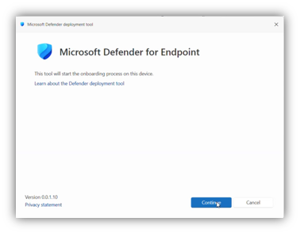
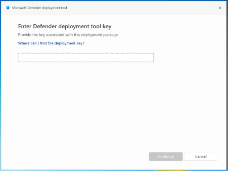

# Onboard devices

**Estimated time:** 15 minutes.

Use the Microsoft Defender portal to create a deployment package and onboard your Windows test device. Intune also supports onboarding for devices it manages.

For more information, see:

- [Use the Microsoft Defender deployment tool for Windows](https://learn.microsoft.com/defender-endpoint/defender-deployment-tool-windows)
- [Onboard Windows devices to Microsoft Defender for Endpoint by using Microsoft Intune](https://learn.microsoft.com/defender-endpoint/configure-endpoints-mdm)

## Create the onboarding package

1. In the Microsoft Defender portal, go to **Setup & configuration** > **Settings** > **Endpoints**. Under **Device management**, select **Onboarding**.
1. Under **Defender deployment tool**, select **Onboard**.
1. On the **Generate Defender deployment tool with an access key** page, enter a unique, descriptive package name, and then select **Generate**.
1. Copy and securely save the key. You can't access the key again after you leave the page.
1. Select **Download deployment tool**.
1. Copy the deployment tool executable to your Windows test device.

## Run the onboarding package

Use either of the following methods:

- To use the executable, double-click it, select **Continue**, and paste the key when prompted.

	

	

- To use the command line, open Command Prompt as an administrator. Use `cd /d "<folder-path>"` to switch to the folder where you extracted or saved the deployment tool executable, replacing `<folder-path>` with the full folder path. Then run:

	```console
	<package-name>.exe -key:"<onboarding-key>"
	```

	Replace both placeholders with the executable name and the key generated for your package. Don't share the key. For a silent installation, append the `-quiet` parameter.

## Verify onboarding

Check **Assets** > **Devices** in the Microsoft Defender portal. If the device doesn't appear yet, verify the local result in the deployment tool log:

```text
C:\ProgramData\Microsoft\DefenderDeploymentTool\DefenderDeploymentTool-<COMPUTERNAME>.log
```

Replace `<COMPUTERNAME>` with the test device name. To review onboarding events, open **Event Viewer**, go to **Windows Logs** > **Application**, and look for events with source **WDATPOnboarding**.

To view deployment packages, go to **Settings** > **Endpoints** > **Deployment packages** in the Microsoft Defender portal.

If you selected the tagged enforcement scope, apply the `MDE-Management` tag to your test device in the Defender device inventory once it appears. When its device record is available in Microsoft Entra, add it to your dedicated test device group and confirm membership.

Device visibility, check-in, and Intune policy reporting can take a few hours. You can [check policy deployment after onboarding](01-manage-endpoint-security.md#verify-deployment-after-onboarding-optional). If the device or results aren't visible yet, continue to Activity 4 and return before offboarding.

[Previous: Configure security settings management](02-security-settings-management.md) | [Lab agenda](README.md) | [Next: Assign safe deployment channels](04-safe-deployment-channels.md)
