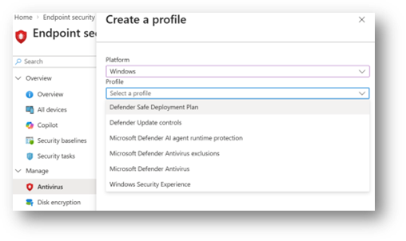
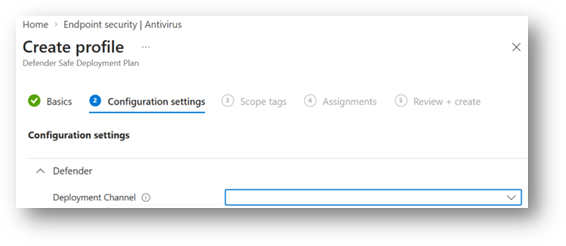

# Assign device groups to safe deployment channels

**Estimated time:** 10 minutes.

Safe deployment plan (SDP) channels help you evaluate Defender changes on an intentionally selected device population before adopting those changes more broadly. The channels build on Microsoft's existing SDP approach and upgrade the [existing platform and engine channels on Windows](https://learn.microsoft.com/defender-endpoint/manage-gradual-rollout).

The new SDP channels are intended to replace existing Defender update-channel constructs. Use the following mappings in a similar way to current update rings.

| Channel | Purpose | Description |
|---|---|---|
| **Validation Channel** | Test updates before others | Devices in this channel are the first to receive new monthly binary platform and engine updates on Windows and platform updates on Linux. Because the likelihood of new issues is higher, add only devices with the highest risk tolerance. The recommended scope is 1% or less of devices in your environment. |
| **Release Channel - Early** | Get release channel updates earlier during gradual release | The release channel is appropriate for most of your production environment. Devices in this channel are offered updates earliest. Distribute devices across early, fast, and broad based on risk tolerance. Earlier channels can surface unexpected behavior sooner and help you gain confidence before broader deployment. |
| **Release Channel - Fast** | Get release channel updates later during gradual release | The release channel is appropriate for most of your production environment. Devices in this channel receive updates later during the gradual release cycle. |
| **Release Channel - Broad** | Get updates at the end of gradual release | The release channel is appropriate for most of your production environment. Devices in this channel receive updates at the end of the gradual release cycle. |
| **Delayed Channel** | Delay Defender updates | Windows devices in this channel are offered updates approximately 48 hours after devices in Release Channel - Broad. For Linux, updates might arrive 2-10 days after rollout to Release Channel - Broad. Use this channel for critical infrastructure and high-value assets. The recommended scope is 1% or less of devices. |
| **Not configured (default)** | Use default behavior | If you don't configure this policy, devices are added to the release channel. Microsoft determines whether devices receive updates earlier or later within the release channel. |

## Create and assign an SDP policy

1. In the Microsoft Intune admin center, go to **Endpoint security** > **Antivirus** > **Create policy**.
1. Select **Windows** for the platform and **Defender Safe Deployment** for the profile, then select **Create**. If the profile isn't available in your tenant, review the channel table and continue to Activity 5 without creating a substitute policy.

	

1. On **Basics**, enter a unique name, such as `Test-Defender-Safe-Deployment`, and select **Next**.
1. Under **Configuration settings**, select the **Deployment Channel** for the policy.

	

1. Assign the policy only to your dedicated test device group.
1. Review the settings and select **Create**.

Policy application can take up to eight hours. To request a check-in for the lab device, use [Policy sync in the Defender portal](01-manage-endpoint-security.md#sync-a-device-managed-by-defender-for-endpoint).

## Verify the deployment channel

After the policy is applied, go to **Endpoints** > **Configuration management** > **Safe deployment dashboard** > **Deployment channels** in the Microsoft Defender portal, if the dashboard is available in your tenant. Confirm that your test device appears in the intended channel. If the dashboard is unavailable or reporting is pending, don't treat the saved policy assignment as confirmation of channel placement.

[Previous: Onboard devices](03-onboard-devices.md) | [Lab agenda](README.md) | [Next: View effective settings](05-effective-settings.md)
