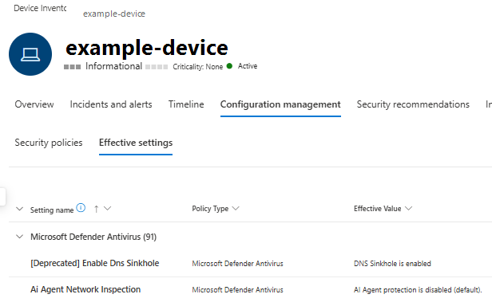

# View effective settings

**Estimated time:** 5 minutes.

Verify the resulting state of the settings by viewing the device's effective settings in the Microsoft Defender portal. Effective settings show the configuration enforced on the device, which helps administrators validate protection and troubleshoot conflicting sources.

For this activity, focus on configuration protection. Verify safe deployment channels using the [channel verification steps in activity 4](04-safe-deployment-channels.md#create-and-assign-an-sdp-policy), rather than relying on the SDP policy appearing in **Effective settings**.

For more information, see [Investigate devices in Microsoft Defender for Endpoint](https://learn.microsoft.com/defender-endpoint/investigate-machines).

1. Open the Microsoft Defender portal.
1. Go to **Assets** > **Devices**.
1. Search for and open the device that you want to review.
1. Select **Configuration management** > **Effective settings**.

	

1. Review the configuration-protection settings from activity 3 and confirm that they reflect the assigned policy. If the state isn't what you expect, return to [Sync and verify configuration protection](03-configuration-protection.md#sync-and-verify-configuration-protection) before drawing conclusions.

[Previous: Assign safe deployment channels](04-safe-deployment-channels.md) | [Lab agenda](README.md) | [Next: Offboard devices](06-offboard-devices.md)
