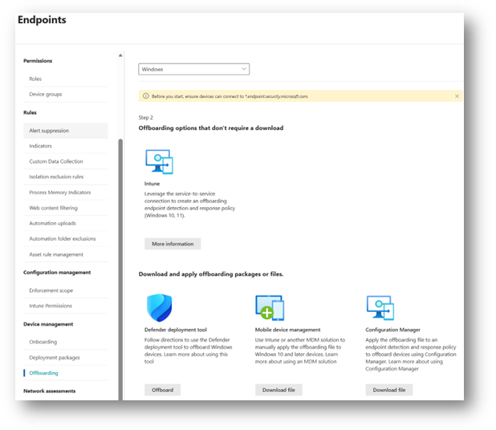
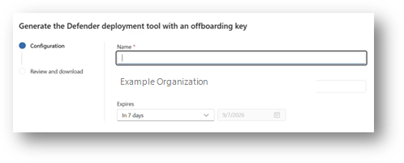

# Offboard devices

**Estimated time:** 10 minutes.

Offboard only the Windows test device you onboarded for this lab. If any [deployment checks](03-manage-endpoint-security.md#verify-deployment-after-onboarding-optional) or [effective settings checks](05-effective-settings.md) you want to perform are pending, return to them before offboarding.

## Enable embedded offboarding

If you haven't already enabled embedded offboarding, see [Verify public preview features](01-security-settings-management.md#verify-public-preview-features). If the embedded experience isn't available, follow the [standard Windows offboarding instructions](https://learn.microsoft.com/en-us/defender-endpoint/offboard-machines) instead of the deployment tool steps below.

## Open the offboarding options

1. In the Microsoft Defender portal, go to **Setup & configuration** > **Settings** > **Endpoints** > **Offboarding** and select **Windows** as the operating system. You can also select **Offboard** from the device inventory.

	

1. Under **Defender deployment tool**, select **Offboard**.

	

## Create the offboarding package

1. On the **Generate Defender deployment tool with an offboarding key** page, enter a unique, descriptive package name.

	

1. Verify that **Organization** is your test tenant. Under **Expires**, choose the shortest practical validity period: **In 7 days** (default), **In 30 days**, or **Custom** (up to one year).
1. Select **Generate**.
1. Copy and securely save the key. You can't access the key again after you leave the page.

	

1. Select **Download deployment tool**. Select the executable or ZIP format based on your organization's needs.
1. Copy the deployment tool executable to your test device.

## Run the offboarding package

Use either of the following methods:

- To use the executable, double-click it, select **Continue**, and paste the key when prompted.
- To use the command line, open Command Prompt as an administrator and run:

	```console
	<package-name>.exe -offboard -key:"<offboarding-key>"
	```

	Replace both placeholders with the executable name and the key generated for your package. Don't share the key. For a silent offboarding experience, append the `-quiet` parameter.

To view offboarding packages, go to **Settings** > **Endpoints** > **Deployment packages** in the Microsoft Defender portal.


## Verify offboarding

Check the deployment tool log for the local result:

```text
C:\ProgramData\Microsoft\DefenderDeploymentTool\DefenderDeploymentTool-<COMPUTERNAME>.log
```

Replace `<COMPUTERNAME>` with the test device name. The tool also records events in **Windows Logs** > **Application** with source **WDATPOffboarding**.

After offboarding, the device stops sending telemetry. Its status changes to **Inactive** 7 days later, and its device profile can remain visible in inventory for up to 180 days. Use the local log or Windows event to confirm offboarding rather than waiting for the device to disappear.

[Previous: View effective settings](05-effective-settings.md) | [Lab agenda](README.md) | [Lab completion](README.md#lab-completion)
