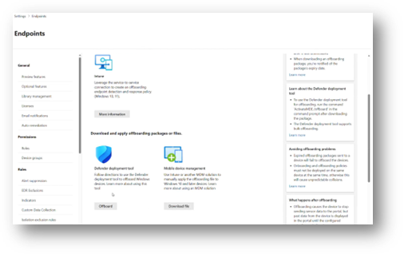
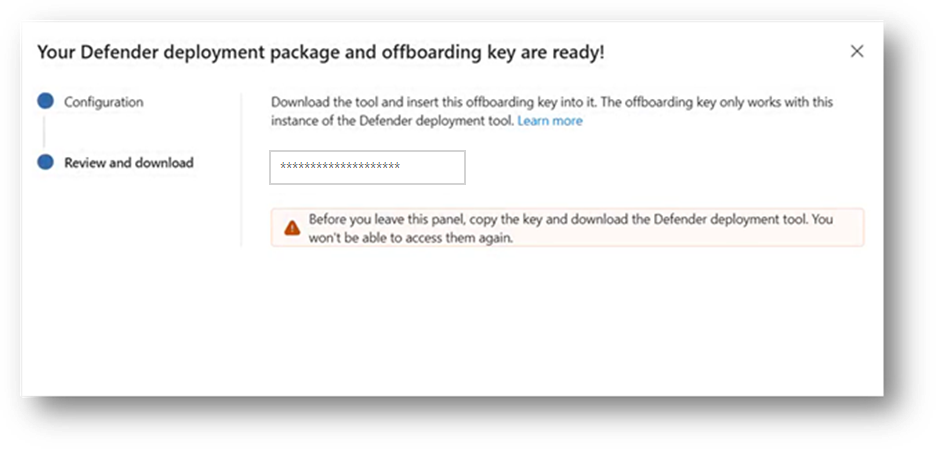
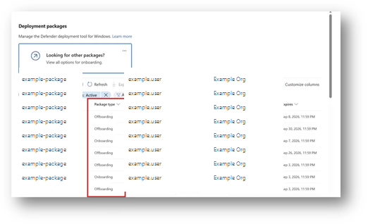

# Offboard devices

**Estimated time:** 10 minutes.

The new SDP private preview experience allows you to enable or disable individual public preview features, giving administrators more deliberate control over feature adoption.

After reviewing effective settings and before offboarding, follow the instructor's direction to [clean up the antivirus and AI policies created for this exercise](03-manage-endpoint-security.md#clean-up-resources). Don't delete shared lab policies.

## Enable embedded offboarding

1. In the Microsoft Defender portal, go to **Settings** > **Endpoints** > **Preview features**.
1. Enable **Embedded offboarding experience**.
1. In the **Endpoints** area, go to **Offboarding** and select **Offboard**.

	

1. Under **Defender deployment tool**, select **Offboard**.

	

## Create the offboarding package

1. On the **Generate Defender deployment tool with an offboarding key** page, enter a unique, descriptive package name.

	

1. Select **Generate**.
1. Copy and securely save the key. You can't access the key again after you leave the page.

	

1. Select **Download deployment tool**. Select the executable or ZIP format based on your organization's needs.
1. Copy the deployment tool executable to the device that you want to offboard.

## Run the offboarding package

Use either of the following methods:

- To use the executable, double-click it, select **Continue**, and paste the key when prompted.
- To use the command line, open Command Prompt as an administrator and run:

	```console
	<package-name>.exe -offboard -key:"<offboarding-key>"
	```

	For a silent offboarding experience, append the `-quiet` parameter.

To view offboarding packages, go to **Settings** > **Endpoints** > **Deployment packages** in the Microsoft Defender portal.



The deployment tool log is located at:

```text
C:\ProgramData\Microsoft\DefenderDeploymentTool\DefenderDeploymentTool-<COMPUTERNAME>.log
```

The tool also records events in **Windows Logs** > **Application** with source **WDATPOffboarding**.

[Previous: View effective settings](05-effective-settings.md) | [Lab agenda](README.md)
